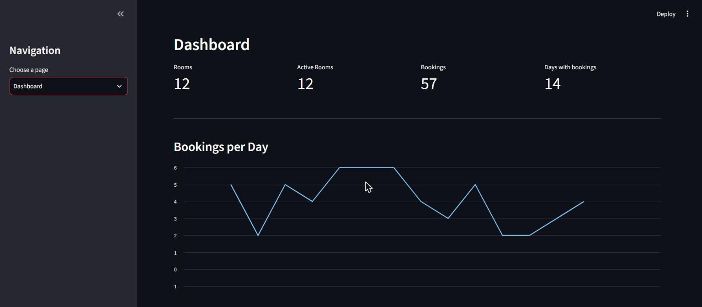
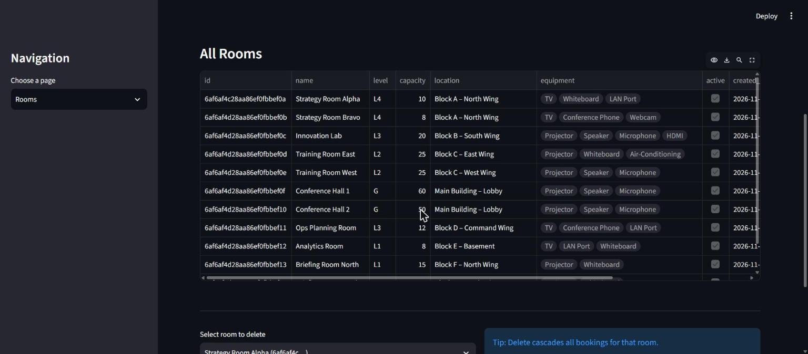
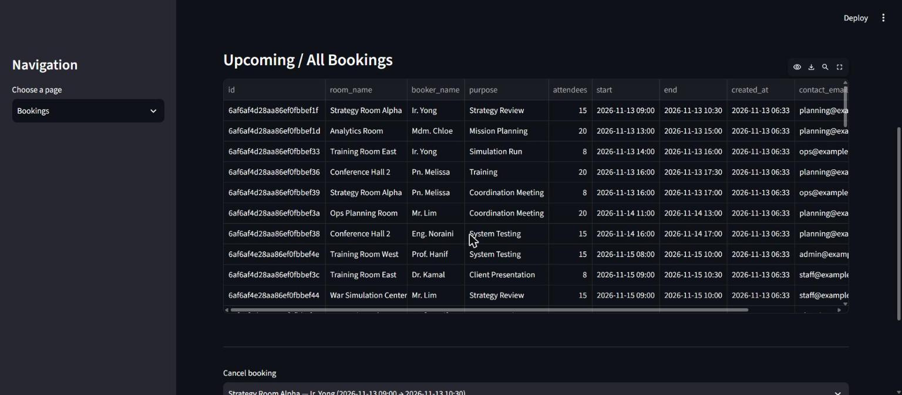

# Room Management System

[](https://github.com/asteraaaaa/Room_Management_System/actions/workflows/ci.yml)
[](LICENSE)


A small room-booking system: a **FastAPI** backend that stores rooms and bookings in **MongoDB**, and a
**Streamlit** web app for managing them. It refuses double bookings, keeps a dashboard of bookings per day,
and comes with a seed script that fills it with demo rooms and bookings.



## Features

- **Rooms**: name, level, capacity, location, equipment, notes and an active flag; create, edit and delete
- **Bookings**: pick a room and a time, with the booker, purpose, attendees and contact details
- **No double bookings**: a booking that overlaps another one in the same room is refused (see below)
- **Dashboard**: totals and a bookings-per-day chart
- **Safe deletes**: deleting a room also deletes its bookings, so the web app asks for confirmation first
- **Demo data**: `seed_api.py` creates 12 rooms and about 60 bookings

| Rooms | Bookings |
|---|---|
|  |  |

All data shown in the screenshots is fictional demo data.

## Quick start

You need **Python 3.10 or newer** and a MongoDB database (for example a free
[MongoDB Atlas](https://www.mongodb.com/atlas) cluster).

```bash
git clone https://github.com/asteraaaaa/Room_Management_System.git
cd Room_Management_System

python -m venv .venv
.venv\Scripts\activate            # Windows (PowerShell or cmd)
# source .venv/bin/activate       # macOS / Linux
pip install -r requirements.txt
```

**1. Configure the database.** Copy `.env.example` to `.env` and put your own connection string in it:

```bash
copy .env.example .env            # Windows
# cp .env.example .env            # macOS / Linux
```

```ini
MONGODB_URI=mongodb+srv://<username>:<password>@<your-cluster-host>/?retryWrites=true&w=majority
DB_NAME=room_mgmt
```

> **Never commit `.env`.** It contains your database password. It is listed in `.gitignore`.

**2. Start the API** (it checks the connection when it starts):

```bash
python fastapi_rooms.py           # http://127.0.0.1:8000   (interactive docs at /docs)
```

**3. Start the web app** in a second terminal:

```bash
streamlit run streamlit_rooms.py  # http://localhost:8501
```

**4. (Optional) add demo data:**

```bash
python seed_api.py                # 12 rooms and about 60 bookings; skips if bookings already exist
python seed_api.py --force        # add another batch of bookings anyway
```

### Settings

| Variable | Used by | Default | Meaning |
|---|---|---|---|
| `MONGODB_URI` | API, `wipe.py` | *(required)* | MongoDB connection string |
| `DB_NAME` | API, `wipe.py` | `room_mgmt` | Database name |
| `API_BASE_URL` | web app, `seed_api.py` | `http://127.0.0.1:8000` | Where the API is running |

## How bookings work

- **Overlap rule.** A new booking is refused (HTTP 409) if, in the same room, another booking starts before
  it ends and ends after it starts. Back-to-back bookings are allowed: 09:00-10:00 and 10:00-11:00 do not clash.
- **No double booking, even at the same instant.** After a booking is stored, the API checks once more and
  withdraws it if anything overlaps, so two simultaneous requests can never both keep the same slot. In a
  true tie both are refused and the person simply tries again.
- **Times.** Send ISO 8601 times such as `2030-06-10T14:30`. An offset (`+08:00`) or a trailing `Z` is
  accepted and converted to UTC; **a time without an offset is taken as UTC**. Results come back as UTC.
- **Inactive rooms** cannot be booked.

## API

Interactive documentation is at <http://127.0.0.1:8000/docs> once the API is running.

| Method | Path | Purpose |
|---|---|---|
| `GET` | `/` | Health check |
| `POST` | `/rooms/` | Create a room (`201`; `400` if the name already exists, case-insensitively) |
| `GET` | `/rooms/` | List rooms, oldest first |
| `PATCH` | `/rooms/{id}` | Change a room. **Only the fields you send change**; `null` clears an optional field. Renaming also updates the name shown on its bookings |
| `DELETE` | `/rooms/{id}` | Delete a room **and all its bookings** |
| `POST` | `/bookings/` | Create a booking (`409` on a time conflict) |
| `GET` | `/bookings/` | List bookings by start time |
| `GET` | `/rooms/{id}/bookings` | Bookings of one room |
| `DELETE` | `/bookings/{id}` | Cancel a booking |

```bash
curl -X POST http://127.0.0.1:8000/rooms/ -H "Content-Type: application/json" \
  -d '{"name": "Briefing Room A", "level": "L2", "capacity": 10, "equipment": ["Projector"]}'

curl -X POST http://127.0.0.1:8000/bookings/ -H "Content-Type: application/json" \
  -d '{"room_id": "<id from above>", "name": "Alice", "start": "2030-06-10T09:00", "end": "2030-06-10T10:00"}'
```

Every text field has a length limit and bad input returns a clear `400` or `422`.

## Tests

The tests never touch a real database: they use [mongomock](https://github.com/mongomock/mongomock), an
in-memory stand-in for MongoDB, and `tests/conftest.py` makes sure the real credential in `.env` cannot be
loaded.

```bash
pip install -r requirements-dev.txt
pytest
```

They cover rooms, bookings (including the overlap rule at every boundary, time zones and the
double-booking race) and both helper scripts. CI runs them on Python 3.10 and 3.12.

## Helper scripts

| Script | What it does |
|---|---|
| `seed_api.py` | Adds demo rooms and bookings through the API. Safe to run again |
| `wipe.py` | **Deletes every room and booking** in the database named in `.env`. It shows the database name and counts, and asks you to type the database name before deleting anything (`--yes` skips the question) |

## Project layout

```
fastapi_rooms.py       the API (rooms, bookings, validation, overlap rule)
streamlit_rooms.py     the web app
seed_api.py            demo data
wipe.py                empties the database (asks first)
tests/                 pytest tests (in-memory database)
.env.example           template for your own .env
```

## Security notes

- **The API has no authentication.** Anyone who can reach it can read, create and delete rooms and bookings.
  It listens on `127.0.0.1` only, so keep it that way, or put it behind a login before exposing it.
- **Keep secrets out of git.** `.env` is ignored. If a database password is ever committed, treat it as
  public: change it in your database provider straight away, because deleting the file later does not remove
  it from the history.

## License

[MIT](LICENSE)
